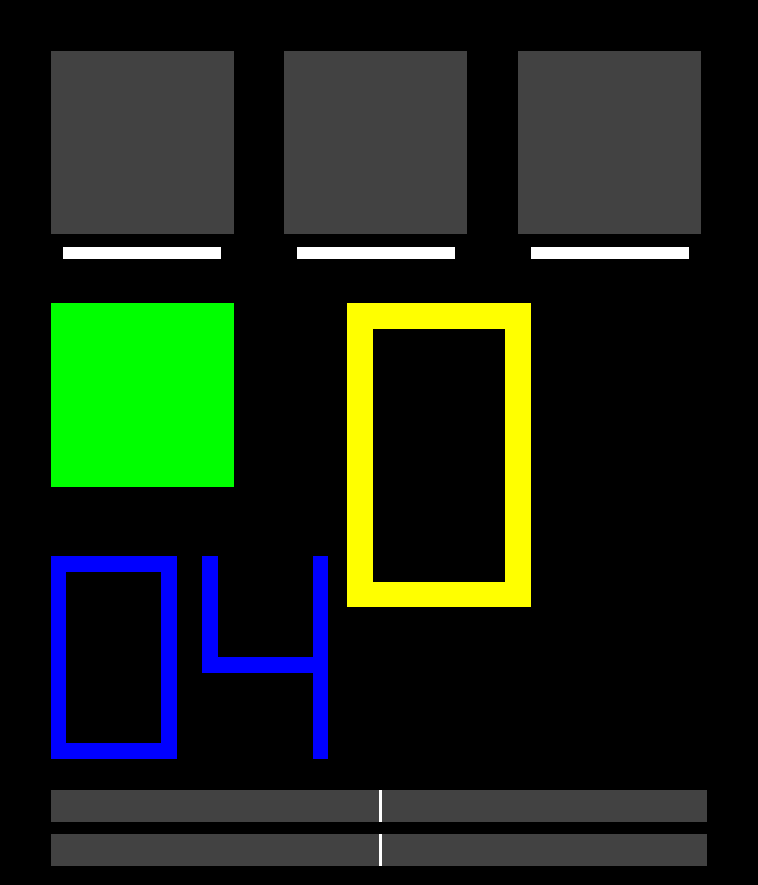

# clawbot 固件示例（ESP32-S3-Touch-LCD-1.69）

POC 数据采集固件：3 路磁接近按键 + 板载 QMI8658C IMU + BLE HID 鼠标 + USB 串口 CSV。
本示例放在 ESP-ADF 仓库的 `examples/clawbot` 下（ADF v3.0 官方示例目录改名 `adf_examples`，此处按本项目约定新建 `examples`）。它只依赖 ESP-IDF，不依赖 ADF 音频组件。

## 1. 接线

板子：ESP32-S3-Touch-LCD-1.69（裸片 S3 + QMI8658C + 16 MB flash）。
开发板排针上引出的空闲脚：**GPIO2 / GPIO3 / GPIO17 / GPIO18 / GPIO38**。
本固件使用：

| 信号 | 开发板引脚 | 接到 | 说明 |
|---|---|---|---|
| HALL_INDEX（食指） | **GPIO2** | 食指传感板 OUT | 内部上拉已开 |
| HALL_MIDDLE（中指） | **GPIO18** | 中指传感板 OUT | 内部上拉已开；GPIO3 是 strapping 脚，留空 |
| HALL_RING（无名指） | **GPIO17** | 无名指传感板 OUT | 内部上拉已开 |
| 3V3 | 排针 `3V3` | 三块传感板 VCC | 与霍尔 pin1 相连 |
| GND | 排针 `GND` | 三块传感板 GND | 与霍尔 pin3 相连 |
| IMU | 板载 | — | I²C：SDA=GPIO11，SCL=GPIO10（与触摸/RTC 共用） |
| USB | USB-C | PC（COM10） | 供电 + 串口 + 烧录 |

**两种引出方式，编号不一样，别混用**：

1. **12P FFC 连接器**（`hardware/ESP32-S3-Touch-LCD-1.69/Pinout.png`）：从上到下 `GPIO18 / GPIO17 / GPIO16 / GPIO3 / GPIO2 / SDA / SCL / U0TXD / U0RXD / 3.3 / GND / 5V`；GPIO16 只在这个连接器上出现。
2. **TP1–TP11 测试点**（原理图）：`TP8=GPIO2、TP9=GPIO3、TP10=GPIO17、TP11=GPIO18、TP3=3V3、TP2=GND`。

焊接前先用万用表确认 `3.3–GND` 为 3.3 V，并确认连接器 1 脚方向（丝印圆点/三角）。

**DRV5032AJDBZR（SOT-23-3）引脚**：`1=VCC`、`2=OUT`、`3=GND`。
不要把 DU 版本的接法套上来（DU 的 pin2/pin3 不同）。

建议每个传感板在 VCC–GND 之间加 100 nF；线长 ≤100 mm 时内部上拉够用，若示波器看到边沿抖动，再在 hub 侧加 100 kΩ 上拉到 3V3。

上电顺序：先接好三路霍尔和电池（或 USB），再烧录；`SYS_EN`（GPIO41）由板载电路自锁，固件不需要额外处理。

## 2. 编译与烧录

```powershell
# 1) 进入 ESP-IDF 环境（本机 IDF 5.5.5）
. E:\esp\esp-idf-5.5.5\export.ps1

# 2) 编译（首次会配置 sdkconfig）
cd firmware\esp-adf\examples\clawbot
idf.py set-target esp32s3
idf.py build

# 3) 烧录并看日志（COM10）
idf.py -p COM10 flash monitor
```

> 本示例不需要 ESP-ADF 的音频组件；如果 `idf.py` 提示 ADF 路径，忽略即可（工程顶层 CMake 只 include IDF 的 project.cmake）。

## 3. 行为

- 霍尔 20 Hz 采样，2 帧去抖；
- 食指 → 鼠标左键，中指 → 右键；
- 无名指：短按无位移（<300 ms，累计角位移 ≤6°）→ 切换离合；
  按住产生 >6° 位移 → 滚动（俯仰映射滚轮）；按住 >300 ms 仍无位移 → 滚动待命，松开不切离合；
- 光标：离合接合且非滚动时，由陀螺积分产生相对位移（`CURSOR_GAIN` 可调）；
- 断开/重连：BLE 断开后自动重新广播。

## 4. CSV 数据流

串口（USB Serial/JTAG）每 50 ms 输出一行：

```text
CSV,t_ms,h_all,h_mid,h_ring,ax,ay,az,gx,gy,gz,clutch,state,btn,wheel,roll,pitch,yaw,bias
```

- `h_*`：1 = 磁铁靠近（霍尔 OUT 低），0 = 离开；
- `ax..az`：g；`gx..gz`：原始 dps（未减零偏）；
- `clutch`：1 接合 / 0 脱开；`state`：0 IDLE / 1 PENDING / 2 SCROLL / 3 STANDBY；
- `btn`：HID 按键位（bit0 左键，bit1 右键）；
- `roll/pitch/yaw`：减零偏后、投影到重力平面坐标系的角速度（dps），yaw 不进入光标；
- `bias`：当前陀螺零偏幅值（dps）。

**上电校准**：固件启动后约 1 s 内采集 100 帧，要求板子静止；这决定初始零偏与水平面。
静止时固件会持续微调零偏（`bias` 会缓慢收敛）。

主机侧采集：

```powershell
python tools\log_serial.py COM10 data\P2_S01_2026-12-04.csv
```

（脚本只依赖 pyserial：`pip install pyserial`。它保留以 `CSV,` 开头的行，并给每行加主机时间戳。）

## 5. 已知限制

- 板载 IMU 与 LCD/触摸同板，功耗数据不代表最终产品（LCD 背光关闭后仍有 RTC/触摸等静态电流）；
- 开发板绑在手背时重量/惯量偏大，手感数据只用于算法与交互验证，不做结构结论；
- 桌面参考平面由重力定义，但轴符号/增益仍是初值（`CURSOR_GAIN`），需按佩戴方向标定；
- ADF 仓库为浅克隆（depth 1），只用于本示例开发，不用于 ADF 自身的音频构建。

## 6. 串口命令（USB Serial/JTAG）

在串口终端（idf.py monitor、串口助手或 `tools/cursor-sim` 网页）里输入：

| 命令 | 作用 | 返回 |
|---|---|---|
| `ble on` | 允许 BLE 广播/连接 | `EVT,ble,1` |
| `ble off` | 停止广播并断开当前主机 | `EVT,ble,0` |
| `ble status` | 查询状态 | `EVT,ble,<enabled>,<connected>` |
| `csv on` / `csv off` | 打开/关闭 CSV 流 | `EVT,csv,1/0` |
| `cal` | 重新做 100 帧静止校准 | `EVT,cal,bias=...` |
| `help` | 命令列表 | `EVT,help,...` |

网页工具：`tools/cursor-sim/index.html`（虚拟光标 + 指标导出，见其 README）。

## 7. LCD 调试页

240×280 ST7789，10 Hz 局部刷新（只重画变化的块，静态背景不重绘；分 32 行带 DMA 传输）。下面是固件绘制逻辑在 `hall=000 / clutch=接合 / state=0 / bias=4` 时的渲染预览：



| 区域 | 含义 |
|---|---|
| 顶部三个方块（左→右） | 食指 / 中指 / 无名指霍尔；绿色 = 有磁 |
| 左侧方块（第二行） | 离合：绿 = 接合，红 = 脱开 |
| 黄色数字 | 状态机：0 IDLE / 1 PENDING / 2 SCROLL / 3 STANDBY |
| 蓝色两位数字 | 当前陀螺零偏（dps，0–99） |
| 底部两条横条 | roll（绿）/ pitch（黄），±100 dps |

## 8. 下一步

1. 标定轴符号与增益：把板子按实际佩戴方向固定，滚转/俯仰各做 10 次，确认光标方向；
2. 采 P1/P2 数据（`patent/applications/DATA-COLLECTION-REQUIREMENTS.md`）；
3. 需要时再把 LCD 页换成文字版（当前为省 Flash 用色块 + 7 段数字）。
